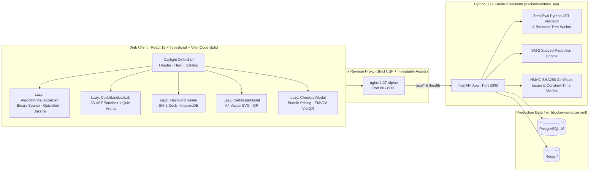

# Solaris Academy v2.0 — Oxford Academic Engineering LMS & Python FastAPI Auto-Grader

[](https://tvt987.github.io/solaris-academy/)
[](#verification--quality-gates)
[](#verification--quality-gates)
[](./docs/ADR-001-ZeroEval-AST-Sandbox-Security.md)

**Solaris Academy v2.0** is a full-stack production engineering Learning Management System (LMS) combining a **Daylight Oxford Academic Paper** React 19 + TypeScript frontend (`#F9FAFB` canvas, `#FFFFFF` structured cards, `#1D4ED8` Oxford Royal Blue, `#059669` Mastery Emerald, `Newsreader` serif course titles paired with `Plus Jakarta Sans` and `JetBrains Mono`, plus optional Dark Mode) with a tested **Python 3.12 FastAPI** zero-eval AST auto-grader, SuperMemo-2 scheduler, and HMAC-SHA256 certificate verification backend.

---

## System Architecture



---

## Key Capabilities

### 1. Daylight Oxford Academic LMS (`src/`)
- **Visual System**: Boots into crisp Daylight Oxford Academic Paper (`#F9FAFB` canvas, `#FFFFFF` course cards, `#1D4ED8` primary royal blue, `#059669` mastery emerald, `#0F172A` editorial ink, `Newsreader` serif course headings) with an optional Evening Study Dark Mode toggle persisted in `localStorage`.
- **Interactive Algorithm Step-Through Visualizer (`algoVisualizerEngine.ts` + `AlgorithmVisualizerLab.tsx`)**:
  - **Binary Search**: `O(log n)` `low` / `mid` / `high` pointers, eliminated regions, and click-to-target cells.
  - **QuickSort (Lomuto Partition)**: Live pivot highlight, animated SVG **swap arcs** with arrowheads, active sub-array bracket, and locked sorted partition markers.
  - **Dijkstra Shortest Path**: Interactive **7-node weighted SVG network (`A`–`G`)** with click-to-select destination node, live Min-Heap Priority Queue, Distance & Predecessor table, and glowing optimal shortest path (`A -> C -> B -> D -> F -> G = 13ms`).
  - Transport controls: Play / Pause, Step Back, Step Forward, Reset, timeline scrubber, speed slider (`0.5x–3.0x`), synchronized pseudocode line trace, and live comparison / swap / relaxation counters.
- **Zero-Eval In-Browser Code Sandbox & Architecture Quiz**: Deterministic JS AST interpreter (`0 eval`, `0 new Function`) enforcing Strict CSP (`script-src 'self'`) and step budgets across 6 production labs + 10 timed architecture questions.
- **SuperMemo-2 (SM-2) Spaced-Repetition Deck**: 3D flip flashcards persisted in `localStorage` + `IndexedDB`, calculating Ease Factor (`EF >= 1.30`) and optimal review intervals.
- **Archival A4 Certificate Studio & EMVCo VietQR Checkout**: 1123×794 landscape vector SVG/PDF certificates with scannable QR verification matrix, checksum verifier, tiered bundle pricing, voucher stacking (`SOLARIS20`), and Techcombank EMVCo CRC-16 VietQR checkout.
- **Route-Level Code Splitting**: `React.lazy` for all 5 interactive workspaces + `vite.config.ts` `manualChunks` (`react`, `engines`, `qrcode`) keeping initial entry JS lean.

### 2. Python 3.12 FastAPI Auto-Grader & Certificate API (`backend/`)
- **Zero-Eval Python AST Security Gate (`backend/solaris_api/grader.py`)**:
  - Statically inspects submitted Python AST before execution — rejects `import`, `from ... import`, `eval`, `exec`, `open`, `class`, `with`, decorators, and any `__dunder__` attribute/name (`__class__`, `__subclasses__`, `__builtins__`, `__import__`) with HTTP `400 AST_SECURITY_VIOLATION`.
  - Executes validated code inside a bounded tree-walking AST interpreter with deterministic step limits (`max_steps`), recursion depth caps (`64`), and collection-size limits (`10,000`).
- **API Endpoints** (Full OpenAPI 3.1 specification in [`docs/openapi.yaml`](./docs/openapi.yaml)):

| Method | Endpoint | Purpose |
| :--- | :--- | :--- |
| `GET` | `/health` | Service readiness & sandbox engine telemetry |
| `POST` | `/api/v1/sandbox/grade` | Static AST security validation + deterministic unit test grading |
| `POST` | `/api/v1/srs/review` | SuperMemo-2 interval, Ease Factor & due timestamp computation |
| `POST` | `/api/v1/certificates/issue` | Deterministic HMAC-SHA256 completion certificate signing |
| `POST` | `/api/v1/certificates/verify` | Constant-time (`hmac.compare_digest`) tamper-resistant verification |

---

## Architecture Decision Records & Contracts

- [OpenAPI 3.1 Specification (`docs/openapi.yaml`)](./docs/openapi.yaml)
- [ADR-001: Zero-Eval Dual-Runtime AST Sandbox Security](./docs/ADR-001-ZeroEval-AST-Sandbox-Security.md)
- [ADR-002: SuperMemo-2 Spaced Repetition Parity & HMAC-SHA256 Certificates](./docs/ADR-002-SM2-SpacedRepetition-HMAC-Certs.md)

---

## Local Development & Docker Quickstart

### Full Stack via Docker Compose (Web + FastAPI + PostgreSQL 16 + Redis 7)
```bash
docker compose up --build
```
- **Web App (Nginx + SPA + `/api` proxy):** `http://localhost:8080`
- **FastAPI Docs (Swagger / OpenAPI):** `http://localhost:8000/docs`
- **Health Check:** `http://localhost:8000/health`

### Run Frontend Locally (Node.js 22+)
```bash
npm ci
npm test        # Runs 47 Vitest unit tests
npm run dev     # Starts Vite dev server on http://localhost:5173
npm run build   # TypeScript check + code-split production bundle
```

### Run Backend Locally (Python 3.12+)
```bash
pip install -r backend/requirements.txt
python -m pytest backend/tests -v
uvicorn solaris_api.main:app --app-dir backend --reload --port 8000
```

---

## Verification & Quality Gates

| Quality Gate | Tool / Scope | Verified Result |
| :--- | :--- | :--- |
| **Gate 1 — Frontend Unit Tests** | `npm test` (Vitest 3.2) | **47 / 47 passed** (`solaris.test.ts`: 25, `algoVisualizerEngine.test.ts`: 22) |
| **Gate 2 — Production Build & Split** | `npm run build` (`tsc -b && vite build`) | **0 errors** · Code-split chunks (`index`: 146.01 kB / 45.25 kB gz, `react`: 223.19 kB, `engines`: 56.04 kB, `AlgorithmVisualizerLab`: 25.56 kB, `qrcode`: 25.39 kB, `CodeSandboxLab`: 18.29 kB, `CertificateModal`: 16.95 kB, `CheckoutModal`: 14.66 kB, `FlashcardTrainer`: 12.04 kB) |
| **Gate 3 — Backend API & Security Tests** | `python -m pytest backend/tests -v` | **27 / 27 passed** (safe grading, infinite-loop step cap, 10 malicious AST `400` blocks, SM-2 progression, HMAC-SHA256 tamper rejection) |
| **Gate 4 — Headless E2E (Desktop & Mobile)** | Playwright against `vite preview` (`1440×900` & `390×844`) | **0 console errors · 0 page errors · 0 failed requests · 0px horizontal overflow** · Verified `#F9FAFB` light boot, Dark toggle, QuickSort swap arcs, Binary Search, Dijkstra 7-node SVG path, AST Sandbox, SM-2, Certificate QR & VietQR |
| **Static Security Audit** | AST + Source Scan | **0** `eval`/`exec`/`new Function`, **0** `dangerouslySetInnerHTML`/`innerHTML`, **0** custom cursors, **0** UI emojis, Strict CSP + `Referrer-Policy` enforced |

---

Built by **Truong Van Tinh (TVT Studio)** — Solution Architect & Full-Stack Engineer.
